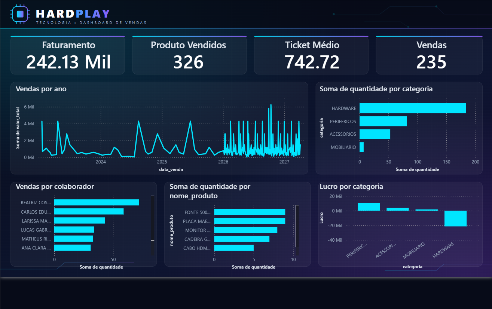
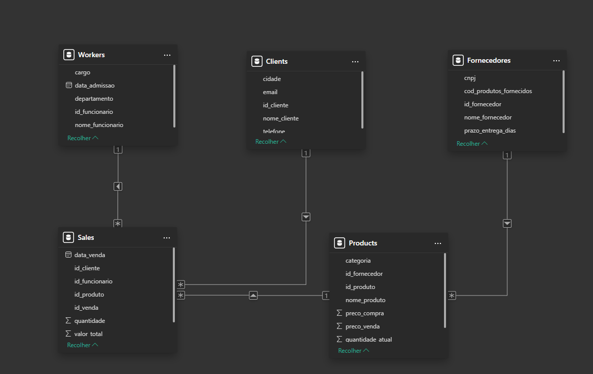
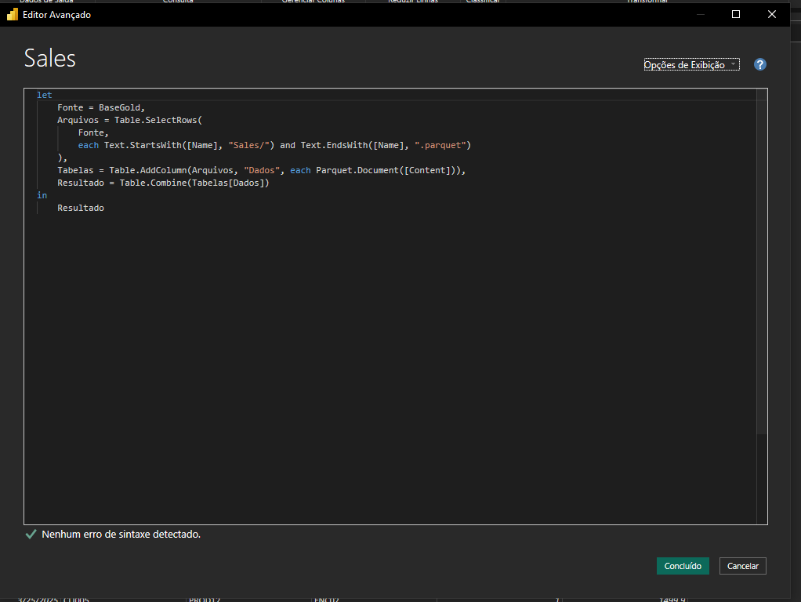

# Hardplay – Documentação do Projeto

## Visão geral

O Hardplay é um sistema de cadastros que grava clientes, fornecedores, produtos, trabalhadores e vendas no Azure e leva esses dados, sem intervenção manual, até um relatório no Power BI.

- **Aplicação (Streamlit):** formulários em abas para cadastrar registros, mais uma tela de consulta.
- **Armazenamento:** conta `deltalake07`, com os contêineres `bronze`, `silver` e `gold`.
- **Processamento (Azure Data Factory):** um arquivo novo na Bronze dispara o pipeline da entidade, que atualiza a Silver e a Gold.
- **Relatório (Power BI):** lê as tabelas da Gold.

## Arquitetura

Os dados passam por três camadas de armazenamento, e um pipeline do Azure Data Factory move cada entidade de uma para a outra.

```
App Streamlit
   -> bronze (CSV por cadastro)
   -> trigger de eventos (Blob created)
   -> Data Flow 1: Bronze -> Silver
   -> Data Flow 2: Silver -> Gold (Parquet)
   -> Power BI (leitura da Gold)
```

O app grava na Bronze, e o trigger aciona o pipeline da entidade, que roda dois Data Flows em sequência: Bronze para Silver e Silver para Gold. O Power BI lê a Gold.

## Aplicação de cadastros (Streamlit)

O arquivo `app.py` tem seis abas. Cada cadastro vira um CSV de uma linha na pasta da entidade, dentro do contêiner `bronze`.

| Aba | Pasta na Bronze | ID automático |
| --- | --- | --- |
| Clientes | `clients/` | CLI137 em diante (3 dígitos) |
| Fornecedores | `fornecedores/` | FOR09 em diante (2 dígitos) |
| Produtos | `products/` | PROD26 em diante (2 dígitos) |
| Trabalhadores | `workers/` | FNC09 em diante (2 dígitos) |
| Vendas | `sales/` | VEN0233 em diante (4 dígitos) |
| Consultar | lê Gold ou Bronze | não se aplica |

Os números iniciais de fornecedor, produto, funcionário e venda foram estimados pelos exemplos do código original. Ajuste-os no bloco de configuração dos IDs, no topo do `app.py`, para o próximo número livre de cada tabela.

### IDs automáticos

O último número usado de cada entidade fica em `bronze/_controle/contador_<prefixo>.txt`. O app lê o contador, grava o novo valor com controle de versão do arquivo (ETag) e só então usa o ID. Se duas pessoas salvarem ao mesmo tempo, uma delas tenta de novo. Um upload que falha deixa um número sem uso. Para reiniciar a contagem, apague o arquivo do contador.

### Validações

- Nome obrigatório em clientes, fornecedores, produtos e trabalhadores.
- Formato de e-mail e CNPJ (pelos dígitos verificadores).
- Preços maiores que zero; aviso quando o preço de venda fica abaixo do de compra.
- Datas de admissão e de venda não podem ser futuras.

### Vendas

1. O produto é escolhido numa lista com ID, nome, preço e estoque, lida da pasta `bronze/products/`.
2. O valor total é calculado: preço de venda × quantidade.
3. O ID do cliente precisa ter cadastro em `bronze/clients/`. Se não tiver, a venda é bloqueada com a orientação de criar o registro na aba Clientes.
4. Se a quantidade for maior que o estoque, a venda é bloqueada.
5. Depois de gravar a venda, o app grava uma nova versão do produto em `bronze/products/` com o estoque reduzido. Se essa etapa falhar, a venda fica salva e o app avisa que o estoque não foi atualizado.

### Consulta

A aba Consultar lê por padrão a Gold (arquivos Delta, Parquet ou CSV em `gold/Clients`, `gold/Fornecedores`, `gold/Products`, `gold/Worker`, `gold/Sales`). A fonte Bronze mostra envios ainda não processados. Há busca em todas as colunas e exportação do resultado em CSV.

## Azure Storage

Tudo fica na conta `deltalake07`, em três contêineres, um por camada. O Azure diferencia maiúsculas de minúsculas nos nomes de pastas.

| Contêiner | Conteúdo | Quem grava |
| --- | --- | --- |
| `bronze` | CSVs brutos em `clients/`, `fornecedores/`, `products/`, `workers/`, `sales/`, e os contadores em `_controle/` | App (Streamlit) |
| `silver` | Dados tratados, um arquivo CSV por entidade (ex.: `Clients/clients_cleaned.csv`) | Data Flows `BS_...` |
| `gold` | Tabelas finais: `Clients`, `Fornecedores`, `Products`, `Worker`, `Sales` (ex.: `Clients/clients.parquet`) | Data Flows `SG_...` |

### Nome dos arquivos da Bronze

Cada cadastro gera `<pasta>/<pasta>_<AAAAMMDD>_<HHMMSS>_<6 caracteres>.csv`, com horário de São Paulo. O sufixo evita que dois envios no mesmo segundo se sobrescrevam. O arquivo histórico de cada entidade fica na mesma pasta (por exemplo `clients_historico.csv` e `products.csv`).

### Colunas gravadas pelo app

| Entidade | Colunas |
| --- | --- |
| Clientes | `id_cliente`, `nome_cliente`, `email`, `telefone`, `cidade` |
| Fornecedores | `id_fornecedor`, `nome_fornecedor`, `cnpj`, `prazo_entrega_dias`, `cod_produtos_fornecidos` |
| Produtos | `id_produto`, `nome_produto`, `categoria`, `id_fornecedor`, `preco_compra`, `preco_venda`, `quantidade_atual` |
| Trabalhadores | `id_funcionario`, `nome_funcionario`, `cargo`, `departamento`, `data_admissao` |
| Vendas | `id_venda`, `data_venda`, `id_cliente`, `id_produto`, `id_funcionario`, `quantidade`, `valor_total` |

## Azure Data Factory

Cada entidade tem um trigger de eventos de armazenamento, um pipeline e dois Data Flows. O trigger só dispara quando um arquivo novo aparece na pasta; sem cadastro novo, nada executa.

### Componentes por entidade

| Entidade | Trigger | Pipeline | Data Flows | Pasta da Bronze |
| --- | --- | --- | --- | --- |
| Clientes | `trg_clients` | `PL_CLIENTS` | `BS_Clients` → `SG_Clients` | `clients/` |
| Fornecedores | `trg_fornecedores` | `PL_FORNECEDORES` | `BS_Fornecedores` → data flow da Gold | `fornecedores/` |
| Produtos | `trg_products` | `PL_PRODUCTS` | `BS_Products` → data flow da Gold | `products/` |
| Trabalhadores | `trg_workers` | `PL_WORKERS` | `BS_Workers` → `SG_Worker` | `workers/` |
| Vendas | `trg_sales` | `PL_SALES` | `BS_Sales` → data flow da Gold | `sales/` |

Na data desta documentação, o fluxo de Clientes, Fornecedores e Vendas já executou com sucesso. O de Trabalhadores ainda precisa de um pipeline associado ao trigger, e o de Produtos precisa do tratamento de versões descrito abaixo.

### Triggers

- Tipo: eventos de armazenamento (`BlobEventsTrigger`), evento **Blob created**.
- Conta `deltalake07`, contêiner `bronze`, caminho que começa com `<pasta>/` e termina com `.csv`.
- O provedor `Microsoft.EventGrid` precisa estar registrado na assinatura.
- O arquivo do contador, em `_controle/`, fica fora dos filtros e não dispara nada.
- O trigger precisa estar associado a um pipeline e publicado (**Publish all**). Eventos só valem para arquivos criados depois da ativação.

### Pipelines

- Duas atividades de Data Flow ligadas por sucesso: Bronze → Silver, depois Silver → Gold.
- **Concurrency = 1**, para duas execuções seguidas não regravarem a mesma pasta ao mesmo tempo.

### Datasets e caminhos

Os datasets da Bronze (`B_...`) apontam para a **pasta** da entidade, sem nome de arquivo. Um nome fixo faz o Data Flow ignorar os CSVs novos.

| Etapa | Onde configurar | Valor |
| --- | --- | --- |
| Leitura da Bronze | Source options → Wildcard paths | `clients/*.csv` (ou a pasta da entidade) |
| Leitura da Silver | Source options → Wildcard paths | `Clients/*.csv` (nome real da pasta, com as mesmas maiúsculas) |
| Saída da Silver | Sink → Settings | Clear the folder, arquivo único (ex.: `clients_cleaned.csv`), Single partition |
| Saída da Gold | Sink → Settings | Clear the folder, arquivo único (ex.: `clients.parquet`), Single partition |

No Wildcard paths, o caminho é lido a partir da raiz do contêiner, então `*.csv` sozinho procura na raiz e não encontra nada.

### Produtos: versões do mesmo item

Cada baixa de estoque cria um novo arquivo do mesmo `id_produto`. O Data Flow `BS_Products` precisa ficar só com a versão mais recente:

1. No source, em **Column to store file name**, usar `arquivo`.
2. **Window** sobre `id_produto`, ordenado por `arquivo` decrescente, com a coluna `rank` = `rowNumber()`.
3. **Filter** com `rank == 1`.
4. Remover `rank` e `arquivo` antes do sink.

A ordem funciona porque `products.csv` vem antes de `products_2026...csv`. Para não depender disso, o arquivo histórico pode se chamar `products_00_historico.csv`.

## Power BI

O Power BI se conecta ao Blob Storage da conta `deltalake07` e lê os arquivos Parquet da Gold. As consultas ficam em seis itens: `BaseGold` (a fonte, com a lista de arquivos), `Clients`, `Fornecedores`, `Products`, `Workers` e `Sales`.

### Leitura de uma tabela

Como o Parquet guarda o nome e o tipo das colunas dentro do arquivo, não há linha de cabeçalho repetida. Cada consulta filtra os arquivos da pasta da entidade em `BaseGold` e combina os resultados:

```
let
    Fonte = BaseGold,
    Arquivos = Table.SelectRows(
        Fonte,
        each Text.StartsWith([Name], "Clients/") and Text.EndsWith([Name], ".parquet")
    ),
    Tabelas = Table.AddColumn(Arquivos, "Dados", each Parquet.Document([Content])),
    Resultado = Table.Combine(Tabelas[Dados])
in
    Resultado
```

Cada consulta deve apontar para a pasta da sua entidade. Os nomes das pastas da Gold são `Clients`, `Fornecedores`, `Products`, `Worker` e `Sales`.

### Atualização

- A Gold tem um arquivo único por entidade, regravado a cada execução do pipeline.
- O Power BI não é acionado pelo ADF. Para atualizar, use **Atualizar visualização** no Desktop ou agende a atualização no Power BI Service (por exemplo, de hora em hora), com a chave da conta de armazenamento como credencial.
- Para disparar a atualização ao fim do pipeline, seria preciso uma atividade Web chamando a API do Power BI, com uma service principal autorizada.

### Prints do Power BI

**Relatório.** Visão geral do painel com os dados da Gold.



**Modelo de dados.** Tabelas e relacionamentos entre clientes, produtos, trabalhadores, fornecedores e vendas.



**Consulta no Power Query.** A consulta `BaseGold`, que lista os arquivos do Blob, e a consulta de uma tabela, que filtra a pasta da entidade e combina os Parquet.



## Guia de operação

### Rodar o app

1. Instale as bibliotecas: `pip install streamlit pandas azure-storage-blob deltalake pyarrow`.
2. No terminal, na pasta do `app.py`, rode `streamlit run app.py`.
3. Ao atualizar o código, pare o Streamlit com `Ctrl+C` e rode de novo. Apertar só "Rerun" no navegador pode manter o arquivo antigo.

### Testar o fluxo de ponta a ponta

1. No app, cadastre um registro (por exemplo, um cliente chamado "Teste ADF").
2. No portal do Azure, confira o CSV novo em `bronze/<pasta>/`.
3. No ADF, abra **Monitor → Trigger runs** e veja o trigger da entidade como *Succeeded*, em até dois minutos.
4. Em **Monitor → Pipeline runs**, acompanhe o pipeline. Cada Data Flow leva alguns minutos, porque sobe um cluster Spark; a primeira execução pode passar de 10 minutos.
5. No portal, confira a data de modificação dos arquivos na `silver` e na `gold`.
6. No Power BI, use **Atualizar visualização** e procure o registro. Na aba Consultar do app, escolha a fonte Gold.

### Diagnóstico rápido

| Sintoma | Causa mais provável | O que fazer |
| --- | --- | --- |
| Trigger não dispara | Trigger não publicado ou sem pipeline associado | Conferir a coluna Related em Manage → Triggers e usar Publish all |
| `InvalidPath` no source | Curinga lido a partir da raiz, ou texto de exemplo no campo | Usar `<pasta>/*.csv` com o nome real da pasta |
| Gold com linhas `NULL` | Data Flow da Gold lê a pasta da Silver errada | Corrigir o dataset e o curinga do source do `SG_...` |
| Linhas duplicadas | Sink em modo de acréscimo, ou o mesmo ID em dois arquivos | Marcar Clear the folder no sink e tratar versões |
| Estoque não diminui | Falha ao gravar o produto novo na Bronze | Ler o aviso do app e conferir `bronze/products/` |
| Lista de produtos vazia na aba Vendas | Nenhum CSV de produtos em `bronze/products/` | Copiar o arquivo histórico para essa pasta |

### Custos

- O toggle **Data flow debug** mantém um cluster ligado e consome crédito. Deixe desligado fora dos testes; ele se desliga sozinho após 60 minutos sem uso.
- Os triggers não têm custo parado, e cada pipeline sobe e desliga o próprio cluster.
- Em Manage → Integration runtimes, deixe o **Time to live** do Data Flow em 0 para o cluster desligar após cada execução.

## Problemas conhecidos, limitações e segurança

A chave da conta de armazenamento está escrita no `app.py` e deve ser tratada como o maior risco do projeto.

### Segurança

- A connection string, com a chave de acesso da conta `deltalake07`, está direto no código. Quem abrir o arquivo tem acesso total ao armazenamento.
- Não suba o `app.py` para o GitHub nem o compartilhe. A chave também passou por uma conversa, então o recomendado é gerar uma nova no portal (Storage account → Access keys → Rotate key) e atualizar o código.
- Antes de publicar o app, mova a connection string para `.streamlit/secrets.toml` ou para uma variável de ambiente e adicione esse arquivo ao `.gitignore`.

### Limitações da arquitetura

- **Estoque como arquivos:** o estoque é regravado como nova versão do produto. Duas vendas do mesmo produto no mesmo instante podem ler o mesmo estoque, e uma baixa sobrescreve a outra. Para uso mais pesado, o estoque deveria ficar num banco transacional, como o Azure SQL.
- **Falha na baixa de estoque:** a venda é gravada antes da baixa. Se a segunda etapa falhar, o app avisa, mas o estoque precisa ser corrigido manualmente.
- **Bronze lida em cada consulta:** a aba Consultar com fonte Bronze e a validação do cliente baixam todos os CSVs da pasta. Com milhares de arquivos fica lenta; a Gold não tem esse problema.
- **Atraso entre cadastro e Gold:** um cadastro novo só aparece na Gold depois que o pipeline termina, o que leva alguns minutos.
- **Sem edição ou exclusão:** o app só insere. Corrigir um cadastro exige gravar uma nova versão do mesmo ID (e a Silver precisa tratar versões, como em produtos) ou editar os arquivos no portal.
- **IDs de relacionamento:** fornecedor, produto e funcionário digitados nos formulários não são validados contra os cadastros. Apenas o ID do cliente na venda e o produto (lista) são conferidos.
- **Números iniciais dos IDs:** os de fornecedor, produto, funcionário e venda foram estimados. Confira o próximo número livre de cada tabela para não duplicar IDs.

## Próximos passos

- [ ] Criar o `PL_WORKERS`, associá-lo ao `trg_workers` e publicar.
- [ ] Ajustar o `BS_Products` com o Window e o Filter que mantêm só a versão mais recente de cada produto.
- [ ] Confirmar o próximo ID livre de fornecedor, produto, funcionário e venda e atualizar o bloco de configuração do `app.py`.
- [ ] Rotacionar a chave da conta de armazenamento e mover a connection string para `secrets.toml`.
- [ ] Trocar os campos de ID de fornecedor, funcionário e produto nos formulários por listas lidas dos cadastros.
- [ ] Apontar a tela Consultar para a Gold em todas as entidades e conferir os nomes das colunas.
- [ ] Agendar a atualização do Power BI no Service, ou disparar o refresh ao fim do pipeline.
- [ ] Configurar alertas de falha em Monitor → Alerts & metrics.
- [ ] Avaliar um banco transacional para o estoque, se o uso crescer.

---

## Documentação do código (app.py)

O `app.py` é um único arquivo Streamlit de \~730 linhas que cadastra clientes, fornecedores, produtos, trabalhadores e vendas, grava cada cadastro como CSV na camada Bronze do Azure e consulta os dados já existentes na Bronze ou na Gold.

### Visão geral

O arquivo é lido de cima para baixo e tem quatro blocos, nesta ordem:

1. **Configuração**: conexão com o Azure, nomes dos containers e regras de numeração dos IDs.
2. **Funções de apoio**: contadores de ID, envio para a Bronze, leitura de cadastros e da Gold, validações.
3. **Interface**: seis abas criadas com `st.tabs`.
4. **Regras da aba Vendas**: cálculo de preço, controle de estoque e checagem de cliente.

O app só **escreve** na Bronze (`bronze/<pasta>/*.csv`). Silver e Gold são gerados pelo Azure Data Factory a partir desses arquivos, e o app apenas **lê** a Gold na aba Consultar.

### Configuração e constantes

Todas as constantes ficam no topo do arquivo (linhas 18 a 47), e é ali que se muda o comportamento do app sem tocar na lógica.

| Constante | Valor atual | Para que serve |
| --- | --- | --- |
| `CONNECTION_STRING` | conta `deltalake07` | Credencial de acesso ao Azure Storage, escrita direto no código |
| `CONTAINER_NAME` | `bronze` | Container onde o app grava os CSVs |
| `CONTAINER_GOLD` | `gold` | Container de onde a aba Consultar lê |
| `FUSO` | `America/Sao_Paulo` | Fuso usado nos nomes de arquivo e na coluna `enviado_em` |
| `ID_CLIENTE` | `("CLI", 137, 3)` | Prefixo, primeiro número e quantidade de dígitos: gera CLI137, CLI138... |
| `ID_FORNECEDOR` | `("FOR", 9, 2)` | FOR09, FOR10... |
| `ID_PRODUTO` | `("PROD", 26, 2)` | PROD26, PROD27... |
| `ID_FUNCIONARIO` | `("FNC", 9, 2)` | FNC09, FNC10... |
| `ID_VENDA` | `("VEN", 233, 4)` | VEN0233, VEN0234... |

O número inicial de cada ID só vale na **primeira** reserva. Depois disso o contador passa a viver no Azure (veja a seção seguinte) e mudar o número no código não tem efeito.

`st.set_page_config` é chamado logo depois das constantes porque o Streamlit exige que seja o primeiro comando dele.

### Infraestrutura: conexão e IDs automáticos

O ID de cada cadastro vem de um contador guardado como arquivo de texto no Azure, em `bronze/_controle/contador_<prefixo>.txt`, que guarda o último número usado. Assim o número não se repete, mesmo com mais de uma pessoa usando o app.

| Função | O que faz |
| --- | --- |
| `obter_connection_string()` | Devolve a `CONNECTION_STRING`. É o ponto único para trocar a origem da chave no futuro. |
| `get_blob_service_client(conn_str)` | Cria o `BlobServiceClient` uma vez só (`st.cache_resource`) e reaproveita em todas as chamadas. |
| `_blob_contador(prefixo)` | Aponta para o arquivo do contador daquela entidade. |
| `_ler_contador(prefixo, inicio)` | Devolve `(último número, etag)`. Se o arquivo não existe, devolve `(inicio - 1, None)`. |
| `previsao_id(config)` | Mostra o próximo ID no formulário **sem reservar**. Em caso de erro mostra "(automático)". |
| `reservar_id(config)` | Reserva e devolve o próximo ID. |

**Como `reservar_id` evita IDs repetidos.** Ela lê o contador junto com o `etag` do arquivo e tenta gravar o número seguinte só se o `etag` não mudou (`MatchConditions.IfNotModified`). Se outra pessoa gravou no meio, o Azure recusa a escrita e a função tenta de novo, até 5 vezes. Na primeira reserva, em que o arquivo ainda não existe, ela cria com `overwrite=False`.

Para reiniciar a numeração de uma entidade, apague o arquivo dela em `_controle/`.

### Gravação e leitura de dados

**`enviar_para_bronze(df, pasta_destino)`** converte o DataFrame em CSV e grava em `bronze/<pasta>/<pasta>_<AAAAMMDD>_<HHMMSS>_<6 hex>.csv`. O sufixo aleatório de 6 caracteres evita que dois envios no mesmo segundo se sobrescrevam, e `overwrite=False` garante isso também no Azure. Devolve o nome do arquivo, ou `None` se falhar (o erro aparece na tela).

**`ENTIDADES`** é o dicionário que liga cada entidade à sua pasta na Bronze e à coluna de ID:

| Entidade | Pasta Bronze | Coluna de ID | Pasta Gold |
| --- | --- | --- | --- |
| Clientes | `clients` | `id_cliente` | `Clients` |
| Fornecedores | `fornecedores` | `id_fornecedor` | `Fornecedores` |
| Produtos | `products` | `id_produto` | `Products` |
| Trabalhadores | `workers` | `id_funcionario` | `Worker` |
| Vendas | `sales` | `id_venda` | `Sales` |

Os nomes das pastas da Gold diferem em maiúsculas e em `Worker` (singular) porque o Azure diferencia maiúsculas de minúsculas. Esse mapa está em `GOLD_PASTAS`.

**`carregar_cadastros(pasta, coluna_id)`** lê todos os CSVs de uma pasta da Bronze (8 downloads em paralelo), junta num DataFrame e adiciona a coluna `enviado_em` com a data de gravação do arquivo. Se o mesmo ID aparece em mais de um arquivo, **fica o envio mais recente**. É assim que o estoque funciona: cada baixa grava uma nova versão do produto. O resultado fica em cache por 60 segundos; o botão Atualizar limpa o cache.

**`cliente_existe(id_cliente)`** limpa o cache e confere se o ID existe na Bronze, ignorando maiúsculas e espaços. Lê a Bronze e não a Gold de propósito: um cliente recém-criado vale na hora, sem esperar o pipeline do ADF.

**`carregar_gold(pasta)`** lê uma tabela da Gold e detecta o formato sozinha, nesta ordem: Delta (pasta `_delta_log`, exige `pip install deltalake`), depois Parquet, depois CSV. Arquivos auxiliares como `_SUCCESS` e `.crc` são ignorados. Também fica em cache por 60 segundos.

`_credenciais_azure()` extrai nome da conta e chave da `CONNECTION_STRING`; só o caminho Delta usa.

### Validações e auxiliares de formulário

| Função | O que faz |
| --- | --- |
| `EMAIL_RE` | Expressão regular simples: algo, `@`, algo, ponto, algo, sem espaços. |
| `validar_cnpj(cnpj)` | Remove o que não é dígito, recusa tamanho diferente de 14 e sequências como `11111111111111`, e confere os dois dígitos verificadores (módulo 11). |
| `preparar_formulario(chave, campos)` | Roda no início de cada aba. Se o cadastro anterior foi salvo, limpa os campos da aba e mostra a mensagem verde com o ID e o caminho do arquivo. |
| `campo_id(rotulo, config)` | Mostra o campo de ID desabilitado, já com o próximo número previsto. |
| `salvar_com_id(...)` | Reserva o ID, monta o DataFrame, envia para a Bronze e recarrega a página. |
| `tem_erros(erros)` | Mostra cada erro como aviso amarelo e devolve `True` se o envio deve parar. |

**Fluxo de `salvar_com_id`:** reserva o ID, cria o DataFrame com `{coluna_id: novo_id, **dados}`, chama `enviar_para_bronze` e, só se o arquivo foi gravado, executa a função opcional `apos_salvar` (usada na venda para baixar o estoque). Se `apos_salvar` falhar, o cadastro **continua salvo** e a tela mostra um aviso de que o estoque não foi atualizado. Por fim guarda o resultado em `st.session_state` e chama `st.rerun()`, que faz `preparar_formulario` limpar os campos e exibir a confirmação.

Um detalhe: o ID é reservado **antes** do envio. Se o envio falhar, aquele número já foi consumido e fica um buraco na sequência. Isso não causa erro, só pula um número.

### Interface: abas e formulários

A tela tem seis abas criadas com `st.tabs`. As cinco de cadastro seguem o mesmo padrão: `preparar_formulario`, um `st.form` com o campo de ID bloqueado, validações depois do envio e, se não houver erro, `salvar_com_id`.

| Aba | Pasta Bronze | Campos gravados | Validações |
| --- | --- | --- | --- |
| Clientes | `clients` | nome\_cliente, email, telefone, cidade | Nome obrigatório; e-mail válido se preenchido |
| Fornecedores | `fornecedores` | nome\_fornecedor, cnpj, prazo\_entrega\_dias, cod\_produtos\_fornecidos | Nome obrigatório; CNPJ válido se preenchido |
| Produtos | `products` | nome\_produto, categoria, id\_fornecedor, preco\_compra, preco\_venda, quantidade\_atual | Nome e fornecedor obrigatórios; preços maiores que zero; aviso (não erro) se venda abaixo da compra |
| Trabalhadores | `workers` | nome\_funcionario, cargo, departamento, data\_admissao | Nome obrigatório; admissão não pode ser futura |
| Vendas | `sales` | data\_venda, id\_cliente, id\_produto, id\_funcionario, quantidade, valor\_total | Veja a próxima seção |
| Consultar | (somente leitura) | — | — |

Categoria, ID do fornecedor, departamento e códigos de produtos são convertidos para maiúsculas antes de gravar.

**Aba Consultar.** Escolhe-se a entidade e a fonte (Gold consolidada ou Bronze com os envios recentes). A busca procura o texto digitado em **todas** as colunas, sem diferenciar maiúsculas. O botão Atualizar limpa os dois caches, e há um botão para baixar o resultado filtrado em CSV. A Gold só mostra cadastros que o pipeline do ADF já processou; para ver um cadastro recém-enviado, use a Bronze.

As chaves dos campos (`cli_nome`, `for_cnpj`, `prod_qtd` e assim por diante) são as mesmas listadas em `preparar_formulario`. Ao criar um campo novo, inclua a chave nessa lista, senão ele não é limpo após o salvamento.

### Regras de venda: preço, estoque e cliente

A aba Vendas não usa `st.form`: os campos ficam soltos para que preço, estoque e total sejam recalculados na hora em que o produto ou a quantidade mudam. O registro só é enviado ao clicar em **Registrar Venda na Bronze**.

**Cálculo.** O produto é escolhido numa lista montada com `carregar_cadastros("products", "id_produto")`, que traz a versão mais recente de cada produto. O preço unitário e o estoque vêm desse cadastro, e o valor total é `round(preco_venda × quantidade, 2)`. O vendedor não digita o preço. As funções `_num` (converte "1234.50" ou "1.234,50" em número) e `_brl` (formata em R$) ficam dentro dessa aba.

**Validações ao clicar**, em ordem; qualquer erro impede o envio:

1. ID do cliente preenchido e **já cadastrado** (`cliente_existe`). Se não, a mensagem manda criar o registro na aba Clientes.
2. Produto selecionado.
3. Quantidade não maior que o estoque disponível.
4. Valor total maior que zero (produto com preço zerado é recusado).
5. ID do funcionário preenchido. O app não confere se ele existe.
6. Data da venda não futura.

**Baixa de estoque.** Depois de gravar a venda, `baixar_estoque()` copia o produto (sem a coluna `enviado_em`), troca `quantidade_atual` por `estoque - quantidade` e grava esse produto como um **novo CSV** em `bronze/products/`. Não se altera o arquivo antigo: a versão mais nova vence. Por isso o Silver de Produtos precisa do Window + Filter `rank == 1` por `id_produto`, que mantém só a versão mais recente de cada produto.

O produto é copiado como dicionário (`produto.to_dict()`) e não como linha do pandas porque colunas de texto do pandas recusam atribuir um número inteiro, o que já causou o erro `Invalid value '11' for dtype 'str'`.

### Como executar e dependências

O app roda com Python 3.10 ou mais novo (usa `zoneinfo`; os tipos `str | None` exigem 3.10).

```bash
pip install streamlit pandas azure-storage-blob pyarrow
pip install deltalake   # só se a Gold estiver em formato Delta
streamlit run app.py
```

| Biblioteca | Uso no código |
| --- | --- |
| `streamlit` | Interface, abas, formulários, cache e estado da sessão |
| `pandas` | DataFrames, leitura e gravação de CSV |
| `azure-storage-blob` | Acesso ao Storage (`BlobServiceClient`) |
| `pyarrow` | Leitura dos Parquet da Gold (`pd.read_parquet`) |
| `deltalake` | Opcional, só para Gold em Delta |

Depois de alterar o `app.py`, pare o Streamlit com Ctrl+C e rode de novo; se o terminal continuar com a versão antiga aberta, a tela não muda.

### Limitações e pontos de atenção

- **Chave do Azure no código.** A `CONNECTION_STRING` está escrita no `app.py`. Não suba o arquivo para o Git assim. Gere uma chave nova no portal Azure e leia a nova de `st.secrets` ou de variável de ambiente.
- **Estoque pode ficar errado com vendas simultâneas.** A baixa lê o estoque, calcula e grava uma nova versão. Se duas pessoas vendem o mesmo produto ao mesmo tempo, as duas partem do mesmo valor e uma baixa se perde. O contador de ID não tem esse problema porque usa `etag`; o estoque não.
- **Venda e baixa não são uma operação só.** Se a venda grava e a baixa falha, a venda fica salva e o app só avisa na tela. O estoque precisa ser corrigido à mão.
- **IDs que não são conferidos.** O app só confere se o cliente existe. O funcionário da venda e o fornecedor do produto são texto livre.
- **Cadastros são só de inclusão.** Não há editar nem excluir. Corrigir um dado exige gravar nova versão no Bronze, e isso só vira substituição se o Silver da entidade deduplicar por ID.
- **Leitura completa a cada consulta.** `carregar_cadastros` baixa todos os CSVs da pasta (cache de 60 s). Com milhares de arquivos fica lento; o remédio é ler a Gold, que é um arquivo só.
- **IDs iniciais estimados.** Os números de partida de fornecedor, produto, funcionário e venda devem ser conferidos contra o último ID real de cada entidade.
